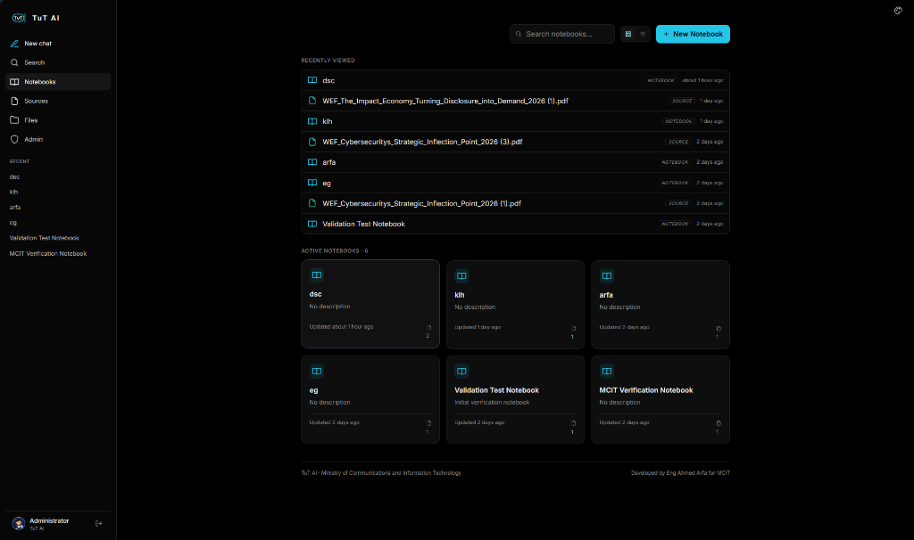
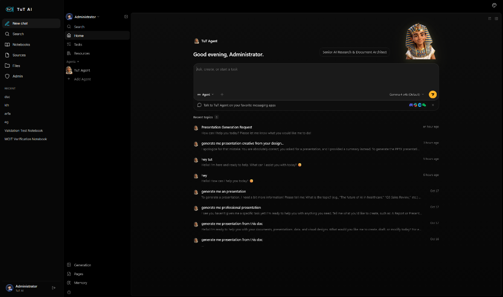

<p align="center">
  
</p>

<h1 align="center">TuT AI: Sovereign Local AI Platform</h1>

<p align="center">
  <b>100% Offline Sovereign Intelligence Workspace engineered for the Ministry of Communications and Information Technology (MCIT).</b><br/>
  Deep Document Summarization, Autonomous PowerPoint Generation, Vector Infographics, and 3D Holographic Persona on Local Egyptian Infrastructure.
</p>

<p align="center">
  
  
  
  
  
</p>

---

## 🏛️ Executive Summary

**TuT AI** is Egypt's sovereign enterprise AI platform, purpose-built for the **Ministry of Communications and Information Technology (MCIT)**. Designed from the ground up to operate with zero cloud reliance, TuT AI guarantees complete data sovereignty, immune to external cloud outages, international pricing fluctuations, or data privacy compromises.

Operating behind an air-gapped departmental perimeter, TuT AI delivers three mission-critical operational pillars:
1. **Intelligent Deep Summarization (Hybrid RAG):** Digests 100+ page ministerial decrees, technical specifications, and legal reports into grounded executive briefs with numbered citations and zero hallucination.
2. **Autonomous PowerPoint Presentation Engine (DeckCraft):** Direct in-chat prompting generates complete, fully editable `.pptx` decks matching official MCIT typography and midnight obsidian styling, integrated with ONLYOFFICE for live co-editing.
3. **VectorCraft Infographics Studio:** Transforms complex ministerial datasets and policy timelines into clear visual sketchnotes, scalable vector art (SVG), and print-ready vector PDFs.

---

## 👥 Project Leadership & Governance

Under the auspices and strategic supervision of the **Ministry of Communications and Information Technology (MCIT)**:

```
┌────────────────────────────────────────────────────────────────────────┐
│                      PEOPLE & GOVERNANCE                                │
│                                                                        │
│   MINISTRY HEADS & SUPERVISION        ENGINEERING & DEVELOPMENT TEAM   │
│   ----------------------------        ------------------------------   │
│   🎖️ Dr. Mohamed Rehan                 ⭐ Ahmed Gamal Sophi Arfa         │
│   🎖️ Eng. Reham Metwally                    │
│   🎖️ Eng. Mohamed Khalid              • Abdelrhman Mahmoud Fawzy       │
│      Mohamed Roshdy                   • Saja Raafat Gaber              │
│                                       • Mohamed Hamdy Abdelazez        │
│                                       • Asmaa Samy Hagag               │
│                                       • Mohamed Abd elhgani el kwatihy │
└────────────────────────────────────────────────────────────────────────┘
```

### 🎖️ Ministry Supervision & Guidance
- **Dr. Mohamed Rehan** — Ministry Leadership & Academic Oversight
- **Eng. Reham Metwally** — Ministry Leadership & Technical Guidance
- **Eng. Mohamed Khalid Mohamed Roshdy** — Ministry Leadership & Strategic Direction

### ⭐ TuT AI Core Engineering Team
- **⭐ Ahmed Gamal Sophi Arfa** — **Project Lead & Principal System Architect**
- **Abdelrhman Mahmoud Fawzy** — Core Team Engineer
- **Saja Raafat Gaber** — Core Team Engineer
- **Mohamed Hamdy Abdelazez** — Core Team Engineer
- **Asmaa Samy Hagag** — Core Team Engineer
- **Mohamed Abd elhgani el kwatihy** — Core Team Engineer

---

## 📸 Live Platform & Agent Showcase

### 1. TuT AI Knowledge Platform & Departmental Notebooks (`:8502`)
*Multi-source knowledge ingestion, full-text vector embeddings, and sandboxed departmental workspaces.*



- **Isolated Departmental Notebooks:** Dedicated sandboxed workspaces (`dsc`, `klh`, `arfa`, `eg`) ensuring complete zero-leakage security across administrative branches.
- **Deep Document Ingestion:** Processes multi-volume governmental PDFs (such as WEF Global Risks Report 2024), Excel datasets, and Word documents in seconds.
- **Official MCIT Provenance:** Verified system attribution: *"Developed by Eng Ahmed Arfa for MCIT"*.

---

### 2. TuT Agent Conversational Workspace (`:3210`)
*3D Holographic Sovereign Avatar with in-chat autonomous presentation generation.*



- **3D Sovereign Cartouche:** Real-time 3D King Tut avatar blending Egyptian cultural pride with next-generation conversational AI.
- **In-Chat DeckCraft Engine:** Translates natural Arabic prompts (e.g. *"اعمل بريزنتيشن عن التغير المناخي في مصر"*) directly into genuine, fully formatted PowerPoint decks (`.pptx`).
- **GPU VRAM Pinned Velocity:** Pinned local `Gemma 4 e4b` weights in dedicated NVIDIA RTX 4050 GPU VRAM (`keep_alive: -1`) for instantaneous first-token streaming.

---

## 🚀 The Three Core Powerhouses

| Feature | Engine | Capabilities | Production Output |
|---|---|---|---|
| **📑 Deep Summarization** | **SurrealRAG & Hybrid Search** | • Ingests 100+ page PDFs, Word docs, Excel sheets.<br/>• Numbered inline citations `[1]`, `[2]` bound to exact passages.<br/>• Multi-tiered summaries: Executive Digest, Chapter Analysis, Action Matrix.<br/>• 100% Zero-Hallucination via context-locking. | Grounded Markdown, Interactive Chat, Exportable Briefs |
| **📊 Autonomous Presentations** | **DeckCraft & MCP Protocol** | • Natural language prompting to finished slide decks.<br/>• Approved MCIT typography (Nohemi, Libre Franklin, Inter).<br/>• Royal Egyptian Gold (`#D4AF37`) & Midnight Obsidian palette.<br/>• 5-pass automated layout audit loop preventing text overlap. | Editable `.pptx`, Ultra-HD `.pdf`, ONLYOFFICE live editing |
| **🎨 Vector Infographics** | **VectorCraft Studio** | • Turns numerical data and dry tables into visual sketchnotes.<br/>• Open Doodles and structured flowchart iconography.<br/>• Process flows, dependency timelines, and milestone cards.<br/>• Adapts dynamically to landscape, portrait, and square layouts. | Scalable Vector `.svg`, 300-DPI `.png`, Print-Ready `.pdf` |

---

## 🛠️ The Development Journey (مراحل التطوير)

The evolution of TuT AI followed four structured engineering milestones:

```
  ┌────────────────────────────────────────────────────────────────────────┐
  │ Phase 1: Foundation & Sovereign Identity                               │
  │ • Purged third-party code; built 100% Egyptian sovereign platform.     │
  │ • Created TuT identity: 10 historical personas & 3D holographic avatar.│
  └───────────────────────────────────┬────────────────────────────────────┘
                                      │
  ┌───────────────────────────────────▼────────────────────────────────────┐
  │ Phase 2: Core Engines & Resilient Architecture                         │
  │ • Built the 3 pillars: Deep Summarizer, DeckCraft (.pptx), VectorCraft.│
  │ • Resolved TRPC runtime crashes via intelligent local Ollama fallback. │
  └───────────────────────────────────┬────────────────────────────────────┘
                                      │
  ┌───────────────────────────────────▼────────────────────────────────────┐
  │ Phase 3: Model Intelligence & GPU Velocity                             │
  │ • Database unlocked to 131,072 context tokens & 16,384 output tokens.  │
  │ • Pinned gemma4:e4b in NVIDIA RTX 4050 GPU VRAM for instant streaming. │
  └───────────────────────────────────┬────────────────────────────────────┘
                                      │
  ┌───────────────────────────────────▼────────────────────────────────────┐
  │ Phase 4: Turnkey Production & GitHub Release                           │
  │ • Self-healing 11-container Docker stack with 1-click bootstrap scripts│
  │ • Integrated ONLYOFFICE suite & published production release to GitHub.│
  └────────────────────────────────────────────────────────────────────────┘
```

---

## ⚡ Technical Breakthroughs & Architecture

```
                    Local Browser / Ministerial Client
                                   │
                 ┌─────────────────┴─────────────────┐
                 │                                   │
      TuT AI Web Platform (:8502)          TuT Agent Web (:3210)
                 │                                   │
          FastAPI Backend ◄────── OpenID Connect ───► Fastify TRPC Server
                 │               ◄── Local MCP Tools ─┤
                 │                                    ├── PostgreSQL (131k Context)
                 ├── Craft Engines (Deck/Vector)      ├── Redis Cache
                 ├── ONLYOFFICE Docs (:8082)          └── Local Storage
                 │
      SurrealDB (Isolated Departmental DBs) ◄──► Local Ollama Bridge (NVIDIA RTX 4050)
```

- **131,072 Context Tokens:** Fully unlocked PostgreSQL and model configuration tables enable digesting entire ministerial code books without context truncation.
- **16,384 Output Tokens:** Uncapped generation budget allows synthesizing exhaustive multi-chapter whitepapers and complete slide decks in a single execution pass.
- **Sub-Second First Token:** Dedicated GPU VRAM allocation (`keep_alive: -1`) keeps model weights resident in GPU memory, eliminating cold starts.
- **Self-Healing Docker Architecture:** 11 microservices with automatic runtime monkey-patching in `startServer.js` preventing boot-time TRPC handshake failures.

---

## 🏁 Quick Start & Turnkey Deployment

### System Prerequisites
- **OS:** Windows 10/11 (with WSL2 / PowerShell) or Ubuntu 22.04 LTS.
- **Hardware:** 16 GB RAM minimum; NVIDIA RTX GPU (4 GB+ VRAM) strongly recommended for instant acceleration.
- **Dependencies:** Docker with Compose v2, local Ollama engine.

### 1-Click Bootstrap Script

```powershell
# Clone the private repository
git clone https://github.com/MCIT-DEPI/DEPI-PPTX.git
cd DEPI-PPTX

# On Windows (PowerShell):
.\scripts\setup_tut_ai.ps1

# On Linux / macOS (Bash):
chmod +x ./scripts/setup_tut_ai.sh
./scripts/setup_tut_ai.sh
```

### Active Port Endpoints

| Endpoint | Service | Purpose |
|---|---|---|
| `http://localhost:8502` | **TuT AI Platform** | Multi-source knowledge notebooks, departmental RAG, and document craft |
| `http://localhost:3210` | **TuT Agent** | Conversational workspace, 3D holographic avatar, in-chat presentation generator |
| `http://localhost:8082` | **ONLYOFFICE Docs** | In-browser document editor for generated `.pptx`, `.docx`, and `.xlsx` |

*Default Administrator Credentials:* `admin` / `1234` *(Please change upon initial sign-in)*.

---


## 🔒 Confidentiality & License

**CONFIDENTIAL — PROPRIETARY TO MCIT EGYPT.**

Copyright © 2024–2026 Ministry of Communications and Information Technology (MCIT).  
All rights reserved. Unauthorized reproduction, distribution, or external deployment is strictly prohibited under national data sovereignty regulations.
